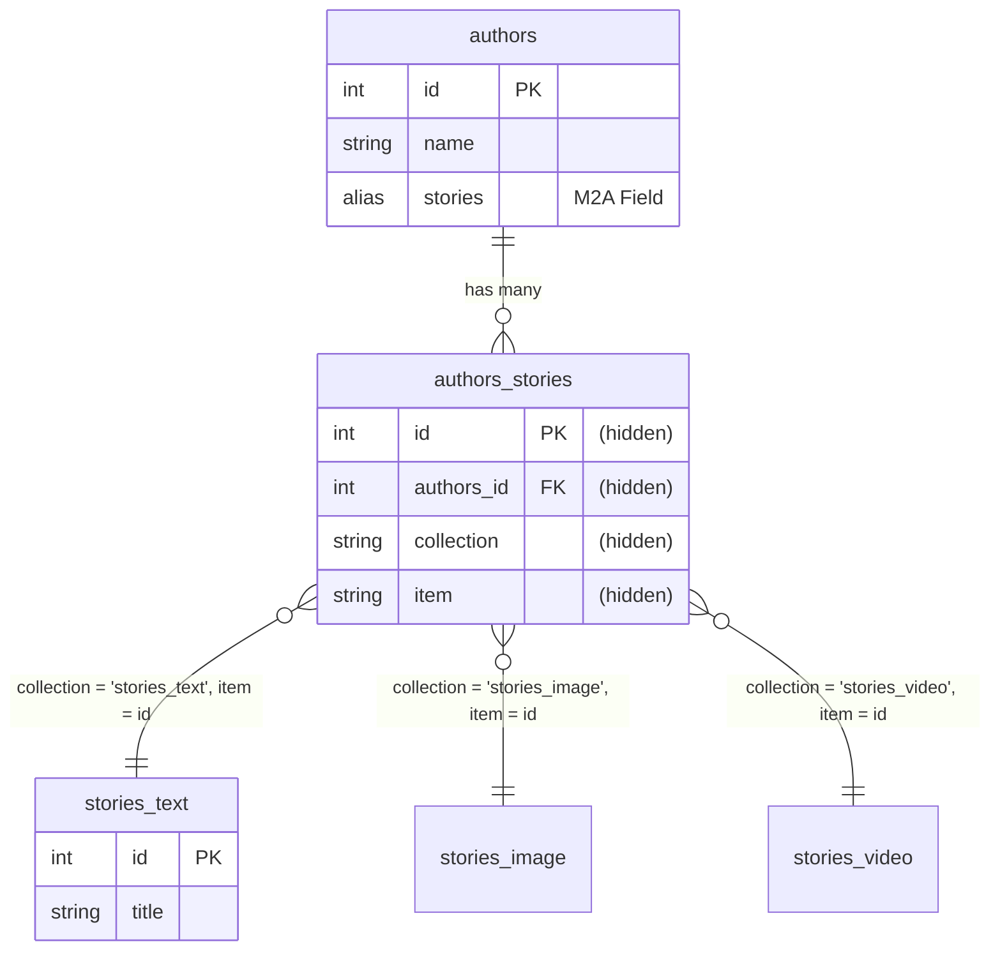
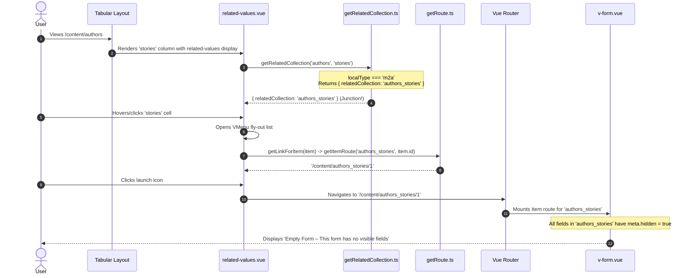

# Technical Analysis: Directus Issue #25427

**Issue Title:** Builder (M2A): Launch-icon opens empty form instead of related item  
**Issue Link:** [directus/directus#25427](https://github.com/directus/directus/issues/25427)  
**Status on Latest Build (`main` @ `b3ce03c18`):** **Reproduced and Verified**

---

## 1. Overview of the Problem

When viewing a collection with a **Many-to-Any (M2A)** field (e.g. `authors.stories`) in the Directus tabular layout, the column displays an item count (e.g., `2 items`) using the `related-values` display.

Hovering or clicking on this count reveals a fly-out list of linked items. Next to each item is a launch icon (`launch`). Clicking this icon is intended to navigate to the related item (e.g. a story item in `stories_text`). Instead, it routes to `/content/authors_stories/<id>`, opening a form for the internal junction collection `authors_stories`.

Because Directus configures all fields in automatically generated junction tables (`id`, `authors_id`, `collection`, `item`) as hidden, the drawer/page displays:

> **Empty Form**  
> *This form has no visible fields.*

---

## 2. Relational Architecture in Directus (M2A vs M2M)

### Relational Setup for M2A

Consider the reproduction schema:
* Parent Collection: `authors`
* Related Collections: `stories_text`, `stories_image`, `stories_video` (each with `id`, `title`)
* M2A Field: `authors.stories`
* Junction Collection: `authors_stories` with columns:
  - `id` (Primary Key)
  - `authors_id` (Foreign Key to `authors.id`)
  - `collection` (Stores string name of target collection, e.g. `'stories_text'`)
  - `item` (Stores target primary key, e.g. `'42'`)



In Directus relational metadata (`directus_relations`), two relation rows govern this field:
1. **Relation 1 (Junction to Parent):**
   - `collection`: `'authors_stories'`
   - `field`: `'authors_id'`
   - `related_collection`: `'authors'`
   - `meta.junction_field`: `'item'`
   - `meta.one_field`: `'stories'`
2. **Relation 2 (Junction to Any):**
   - `collection`: `'authors_stories'`
   - `field`: `'item'`
   - `related_collection`: `null`
   - `meta.one_collection_field`: `'collection'`
   - `meta.one_allowed_collections`: `['stories_text', 'stories_image', 'stories_video']`
   - `meta.junction_field`: `'authors_id'`

---

## 3. Step-by-Step Code Execution Trace

Here is the exact chain of calls in the latest build that triggers the bug:



### Detailed Breakdown of Each Step

### Step 1: `app/src/utils/get-related-collection.ts`

```ts
const o2mTypes = ['o2m', 'm2m', 'm2a', 'translations', 'files'];

if (localType && o2mTypes.includes(localType)) {
    if (localType == 'm2m' && relations.length > 1) {
        return {
            relatedCollection: relations[1].related_collection!,
            junctionCollection: relations[0].collection,
            path: [relations[1].field],
        };
    }

    return { relatedCollection: relations[0].collection };
}
```
* For `localType === 'm2m'`, the function branches off to inspect `relations[1]` and returns `relatedCollection` as the true related collection, while setting `junctionCollection` as the junction table and `path` to the foreign key field.
* For `localType === 'm2a'`, it hits the fall-through `return { relatedCollection: relations[0].collection };`.
* `relations[0].collection` is `'authors_stories'` (the junction table).
* As a result, `relatedCollection` is set to `'authors_stories'`, and both `junctionCollection` and `path` remain `undefined`.

---

### Step 2: `app/src/displays/related-values/related-values.vue`

```ts
const relatedCollectionData = computed(() => {
    return getRelatedCollection(props.collection, props.field);
});

const relatedCollection = computed(() => {
    return relatedCollectionData.value!.relatedCollection; // 'authors_stories'
});

const junctionCollection = computed(() => {
    return relatedCollectionData.value!.junctionCollection; // undefined
});

const { primaryKeyField } = useCollection(relatedCollection);

const primaryKeyFieldPath = computed(() => {
    return relatedCollectionData.value!.path
        ? [...relatedCollectionData.value!.path, primaryKeyField.value?.field].join('.')
        : primaryKeyField.value?.field; // 'id'
});
```

Because `relatedCollectionData.value!.path` is `undefined`, `primaryKeyFieldPath` defaults directly to the primary key of `authors_stories`, which is `'id'`.

---

### Step 3: `getLinkForItem` in `related-values.vue`

```ts
function getLinkForItem(item: any) {
    if (!relatedCollectionData.value || !primaryKeyFieldPath.value) return null;
    const primaryKey = get(item, primaryKeyFieldPath.value);

    return getItemRoute(relatedCollection.value, primaryKey);
}
```

When rendering each junction row `item`:
```json
{
  "id": 1,
  "authors_id": 10,
  "collection": "stories_text",
  "item": {
    "id": 42,
    "title": "First Story"
  }
}
```
* `primaryKey = get(item, 'id')` retrieves `1` (the junction record ID).
* `getItemRoute(relatedCollection.value, primaryKey)` is called as:
  `getItemRoute('authors_stories', 1)`
* `getItemRoute` in `app/src/utils/get-route.ts` returns `'/content/authors_stories/1'`.

---

### Step 4: Launch Icon in the Template

In `app/src/displays/related-values/related-values.vue`:

```html
<VList class="links">
    <VListItem v-for="item in value" :key="item[primaryKeyFieldPath!]">
        <VListItemContent>
            <RenderTemplate
                :template="internalTemplate"
                :item="item"
                :collection="junctionCollection ?? relatedCollection"
            />
        </VListItemContent>
        <VListItemIcon>
            <RouterLink :to="getLinkForItem(item)!"><VIcon name="launch" small /></RouterLink>
        </VListItemIcon>
    </VListItem>
</VList>
```

The user clicks `<RouterLink :to="'/content/authors_stories/1'">`.

---

### Step 5: Form Rendering in `app/src/components/v-form/v-form.vue`

The route `/content/authors_stories/1` loads the item editor view. Because `authors_stories` is an internal junction collection, Directus hides all junction columns by default (`field.meta.hidden = true`).

When `v-form.vue` checks for visible fields:
```ts
const noVisibleFields = computed(() => {
    return fieldNames.value.every((fieldName) => {
        return fieldsMap.value[fieldName]?.meta?.hidden === true;
    });
});
```
Because `noVisibleFields` evaluates to `true`, the form displays:
```html
<VInfo
    v-if="noVisibleFields && showNoVisibleFields"
    :title="$t('no_visible_fields')"
    :icon="inline ? false : 'search'"
    :center="!inline"
>
    {{ $t('no_visible_fields_copy') }}
</VInfo>
```
Which corresponds to:
> **Empty Form – This form has no visible fields.**

---

## 4. Comparison Table: Relational Types in `related-values`

| Relationship Type | `localType` | `getRelatedCollection` Return | Route Generated for Item | Target Item Opened | Result |
| :--- | :--- | :--- | :--- | :--- | :--- |
| **O2M** | `o2m` | `{ relatedCollection: 'stories' }` | `/content/stories/:id` | Story Item | ✅ Correct |
| **M2M** | `m2m` | `{ relatedCollection: 'categories', junctionCollection: '...', path: ['category_id'] }` | `/content/categories/:id` | Category Item | ✅ Correct |
| **M2A** | `m2a` | `{ relatedCollection: 'authors_stories' }` | `/content/authors_stories/:junctionId` | Junction Item | ❌ **Empty Form** |

---

## 5. Summary of Key Root Causes

1. **Junction Collection Ambiguity:** `getRelatedCollection` treats `m2a` identically to simple `o2m`, returning the junction collection as `relatedCollection` without identifying the polymorphic relation.
2. **Static Route Resolution in Display:** `related-values.vue` assumes a single static `relatedCollection` for all items in `value`. In M2A, each row in `value` can belong to a **different target collection**, defined dynamically by `item[collectionField]` (e.g. `stories_text`, `stories_image`, `stories_video`).
3. **Primary Key Resolution:** In M2A, the related item's primary key is inside `item[junctionField]` (e.g. `item.item.id` or `item.item`), rather than the junction record's primary key (`item.id`).
